<!-- ═══════════════════════ GREAT HALL ═══════════════════════ -->

 

  

 

 

<!-- ═══════════════════════ THE LETTER ═══════════════════════ -->

<!-- ═══════════════════════ SPELLBOOK ═══════════════════════ -->

 

***Charms I cast daily***

***Spells still in study at the library***

  

<!-- ═══════════════════════ SORTING CEREMONY ═══════════════════════ -->

<i>“Hmm, difficult. Very difficult. Plenty of courage, I see. Not a bad mind, either…”</i>

<!-- ═══════════════════════ RESTRICTED SECTION ═══════════════════════ -->

<i>More tomes are being written by candlelight…</i>

<!-- ═══════════════════════ PENSIEVE ═══════════════════════ -->

 

  

<picture>
  <source media="(prefers-color-scheme: dark)" srcset="https://raw.githubusercontent.com/MaybeIceloveU2/MaybeIceloveU2/output/snitch-chase-dark.svg" />
  
</picture>

<!-- ═══════════════════════ OWL POST ═══════════════════════ -->

 

  

